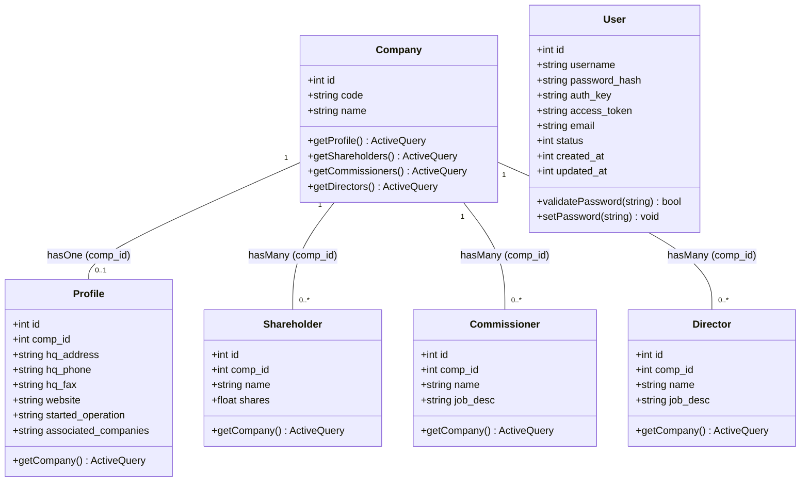

# Catatan Pengembangan (Development Notes)
**Proyek: Simple Profile (Modernisasi Yii 1 ke Yii 2)**

Dokumen ini mencatat secara terperinci keputusan teknis, arsitektur perangkat lunak, struktur modul, dan tahapan implementasi dalam pengembangan aplikasi **Simple Profile** berbasis **Yii 2.0.54** (`yii2app/`).

---

## 1. Latar Belakang & Tujuan Pengembangan

Aplikasi Simple Profile berawal dari Proof-of-Concept (PoC) berbasis Yii 1.1.15 yang berfokus pada pencatatan data ringkas profil emiten Bursa Efek Indonesia (IDX). Tujuan dari fase pengembangan ini adalah:

1. **Modernisasi Arsitektur**: Mengadopsi standar PHP modern (PHP 8.4, namespaces, PSR-4, Composer autoloader).
2. **Peningkatan ORM (ActiveRecord)**: Menggantikan query manual Yii 1 dengan relasi deklaratif `hasOne` dan `hasMany` serta mendukung *eager loading*.
3. **Pembaruan Antarmuka (UI/UX)**: Mengganti tampilan Blueprint CSS dengan Bootstrap 4 interaktif berbasis Tabs.
4. **Keamanan & Otentikasi Terintegrasi**: Mengganti otentikasi hardcoded array menjadi otentikasi basis data dengan enkripsi kata sandi aman (bcrypt).
5. **Standarisasi Skema Basis Data**: Mengonversi tabel dari `MyISAM` ke `InnoDB` dengan charset `utf8mb4` untuk integritas foreign key.

---

## 2. Arsitektur Model & Desain Relasi ActiveRecord

Seluruh model bisnis ditempatkan pada namespace `app\models` dan mewarisi `yii\db\ActiveRecord`.



### Transformasi Entitas dari Yii 1 ke Yii 2
- `companies` $\rightarrow$ `app\models\Company` ([`Company.php`](yii2app/models/Company.php))
- `profiles` $\rightarrow$ `app\models\Profile` ([`Profile.php`](yii2app/models/Profile.php))
- `shareholders` $\rightarrow$ `app\models\Shareholder` ([`Shareholder.php`](yii2app/models/Shareholder.php))
- `commisioners` $\rightarrow$ `app\models\Commissioner` ([`Commissioner.php`](yii2app/models/Commissioner.php))
- `directors` $\rightarrow$ `app\models\Director` ([`Director.php`](yii2app/models/Director.php))
- *User Identity* $\rightarrow$ `app\models\User` ([`User.php`](yii2app/models/User.php))

### Strategi Query Eager Loading
Untuk mencegah bottleneck performa query $N+1$, pengambilan data profil dan entitas anak dilakukan dalam satu instruksi query terpadu:
```php
$model = Company::find()
    ->where(['id' => $id])
    ->with(['profile', 'shareholders', 'commissioners', 'directors'])
    ->one();
```

---

## 3. Implementasi Antarmuka Master-Detail (Bootstrap 4 Tabs)

Tampilan detail emiten dirombak total dari tampilan vertikal panjang di Yii 1 menjadi tampilan tabular interaktif di Yii 2:

### Komponen View ([`yii2app/views/company/view.php`](yii2app/views/company/view.php))
1. **Header Card Emiten**: Menampilkan badge kode saham IDX (misal `BBCA`), nama lengkap perusahaan, ID internal, serta navigasi aksi (*Kembali*, *Edit Perusahaan*, *Hapus*).
2. **Interactive Tab Widget (`yii\bootstrap4\Tabs`)**:
   - **Tab 1: Profil Perusahaan (`_profile_tab.php`)**:
     - Memanfaatkan `DetailView` untuk menampilkan alamat, telepon, fax, tahun pendirian, dan afiliasi.
     - Deteksi otomatis protokol link situs web (`http://` / `https://`) yang terbuka di tab baru (`target="_blank"`).
     - *Empty State*: Menampilkan alert informatif dengan tombol `+ Tambah Profil` jika belum ada profil.
   - **Tab 2: Pemegang Saham (`_shareholders_tab.php`)**:
     - `GridView` dengan format persentase saham `XX,XX %`.
     - Tombol cepat untuk menambah, mengedit, dan menghapus pemegang saham.
   - **Tab 3: Dewan Komisaris (`_commissioners_tab.php`)**:
     - `GridView` dengan badge peran/jabatan dewan komisaris.
   - **Tab 4: Dewan Direksi (`_directors_tab.php`)**:
     - `GridView` dengan badge peran/jabatan jajaran direksi.

### Controller Anak (Sub-Entity Controllers)
Untuk menjaga modularitas kode, setiap entitas anak memiliki controller khusus:
- [`ProfileController.php`](yii2app/controllers/ProfileController.php)
- [`ShareholderController.php`](yii2app/controllers/ShareholderController.php)
- [`CommissionerController.php`](yii2app/controllers/CommissionerController.php)
- [`DirectorController.php`](yii2app/controllers/DirectorController.php)

Setiap aksi pembuatan dan pengeditan entitas anak menerima parameter `$comp_id`, otomatis mengisinya via `hiddenInput`, dan mengalihkan pengguna kembali ke tab emiten terkait (`['company/view', 'id' => $model->comp_id]`).

---

## 4. Sistem Otentikasi & Keamanan (Password Hashing)

### Model `app\models\User`
Otentikasi telah dipindahkan ke basis data melalui tabel `users`:
- **Implementasi Interface**: `yii\web\IdentityInterface`
- **Algoritma Hashing**: Menggunakan `Yii::$app->security->generatePasswordHash($password)` berbasis bcrypt.
- **Validasi Password**: `Yii::$app->security->validatePassword($password, $this->password_hash)`.
- **Fitur Remember Me**: Menggunakan `auth_key` sepanjang 32 karakter acak yang dibuat otomatis via event `beforeSave()`.
- **Dukungan API**: Field `access_token` disiapkan untuk otentikasi Bearer Token RESTful API.
- **Otomatisasi Timestamp**: Menggunakan `yii\behaviors\TimestampBehavior` untuk mengelola `created_at` dan `updated_at`.

---

## 5. Modernisasi Skema Basis Data

File DDL basis data [`db/create-database.sql`](db/create-database.sql) diperbarui dengan ketentuan:
1. **Engine**: Menggunakan `ENGINE=InnoDB` di semua tabel untuk mendukung constraint `FOREIGN KEY ... ON UPDATE CASCADE ON DELETE RESTRICT`.
2. **Karakter Set**: Menggunakan `utf8mb4` untuk kepatuhan standar penyimpanan data modern.
3. **Migration Yii 2**: Dibuat file migration terstandarisasi [`m230101_000000_create_users_table.php`](yii2app/migrations/m230101_000000_create_users_table.php) untuk deployment otomatis.

---

## 6. Konfigurasi Lingkungan Lokal (PHPbrew 8.4)

Untuk mendukung dependensi modern Yii 2 (Yii 2.0.54, Codeception 5, Symfony Mailer 2) di openSUSE Leap 15.6:
1. **PHPbrew Build**:
   ```bash
   sudo zypper install oniguruma-devel libzip-devel
   phpbrew install 8.4 +default +mysql --no-patch
   ```
2. **Koneksi Database TCP**:
   Pada [`yii2app/config/db.php`](yii2app/config/db.php), DSN disetel ke `mysql:host=127.0.0.1;port=3306;dbname=simple_profile` untuk portabilitas koneksi tanpa ketergantungan path socket unix lokal.
