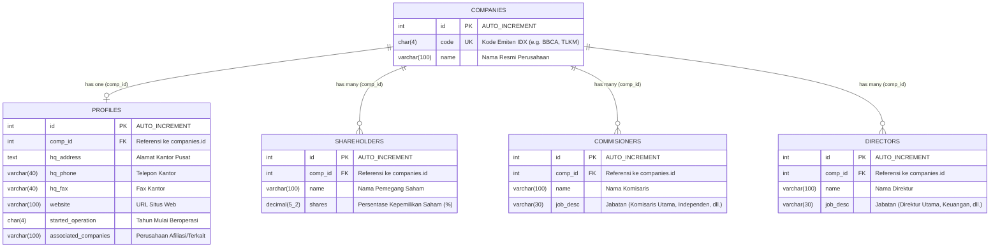
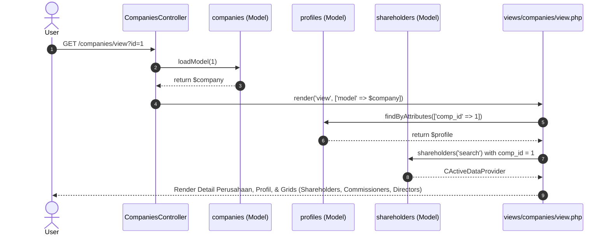

# Dokumentasi Implementasi Aplikasi Yii 1 (PoC)

Dokumentasi ini menjelaskan secara komprehensif implementasi teknis dari aplikasi **Simple Profile** versi Proof of Concept (PoC) yang dibangun menggunakan framework **Yii 1.1.15**.

---

## Daftar Isi
1. [Arsitektur & Struktur Direktori](#1-arsitektur--struktur-direktori)
2. [Skema Basis Data & Entitas](#2-skema-basis-data--entitas)
3. [Konfigurasi & Siklus Hidup Aplikasi](#3-konfigurasi--siklus-hidup-aplikasi)
4. [Komponen & Otentikasi](#4-komponen--otentikasi)
5. [Detail Model (ActiveRecord)](#5-detail-model-activerecord)
6. [Detail Controller & Alur Kerja (Workflows)](#6-detail-controller--alur-kerja-workflows)
7. [Tampilan Antarmuka & Widgets (Views)](#7-tampilan-antarmuka--widgets-views)
8. [Panduan Menjalankan Aplikasi](#8-panduan-menjalankan-aplikasi)
9. [Temuan Teknis & Catatan Refaktoring untuk Migrasi Yii 2](#9-temuan-teknis--catatan-refaktoring-untuk-migrasi-yii-2)

---

## 1. Arsitektur & Struktur Direktori

Aplikasi Yii 1 berada di bawah direktori `www/` dan menggunakan framework Yii 1.1 yang di-bundle langsung di direktori root `/framework/`.

```text
simple-profile/
├── framework/                 # Bundle source framework Yii 1.1.15
│   ├── yii.php                # Bootstrap framework utama
│   ├── YiiBase.php            # Core class loader & helper Yii
│   └── ...
├── db/                        # Skrip inisialisasi basis data
│   ├── create-database.sql    # DDL tabel relasional
│   └── create-user.sql        # Pembuatan user MySQL
└── www/                       # Web Document Root
    ├── index.php              # Entry script aplikasi web
    ├── index-test.php         # Entry script untuk pengujian fungsional
    ├── css/                   # Aset stylesheet (Blueprint framework & custom)
    └── protected/             # Direktori kode aplikasi terproteksi
        ├── components/        # Komponen kustom (UserIdentity, Controller)
        ├── config/            # File konfigurasi (main.php, console.php, test.php)
        ├── controllers/       # Controller MVC
        ├── models/            # Model ActiveRecord & form model
        ├── runtime/           # File cache & log aplikasi (application.log)
        └── views/             # Template tampilan dan layout
```

### Bootstrap Aplikasi (`www/index.php`)
```php
$yii = dirname(__FILE__).'/../framework/yii.php';
$config = dirname(__FILE__).'/protected/config/main.php';

defined('YII_DEBUG') or define('YII_DEBUG', true);
defined('YII_TRACE_LEVEL') or define('YII_TRACE_LEVEL', 3);

require_once($yii);
Yii::createWebApplication($config)->run();
```

---

## 2. Skema Basis Data & Entitas

Basis data menggunakan MySQL dengan nama database `simple_profile`. Relasi antar-entitas berpusat pada entitas `companies`.



---

## 3. Konfigurasi & Siklus Hidup Aplikasi

Konfigurasi inti berada pada `www/protected/config/main.php`:

- **Nama Aplikasi**: `Company Profile`
- **Import Otomatis**:
  - `application.models.*`
  - `application.components.*`
- **Routing URL Manager**:
  Format `path` diaktifkan dengan aturan:
  - `<controller:\w+>/<id:\d+>` $\rightarrow$ `<controller>/view`
  - `<controller:\w+>/<action:\w+>/<id:\d+>` $\rightarrow$ `<controller>/<action>`
  - `<controller:\w+>/<action:\w+>` $\rightarrow$ `<controller>/<action>`
- **Koneksi Database Default**:
  - DSN: `mysql:host=localhost;dbname=simple_profile`
  - User: `sp` / Password: `sp`
  - Emulate Prepare: `true`, Charset: `utf8`
- **Gii Code Generator**:
  - Path: `system.gii.GiiModule`
  - Password akses: `profile`
  - Filter IP: `127.0.0.1`, `::1`

---

## 4. Komponen & Otentikasi

### A. Otentikasi Pengguna (`www/protected/components/UserIdentity.php`)
Otentikasi menggunakan in-memory array akun bawaan (demo mode):
- `demo` / `demo` (User biasa)
- `admin` / `admin` (Administrator)

```php
public function authenticate()
{
    $users = array(
        'demo'  => 'demo',
        'admin' => 'admin',
    );
    if (!isset($users[$this->username]))
        $this->errorCode = self::ERROR_USERNAME_INVALID;
    elseif ($users[$this->username] !== $this->password)
        $this->errorCode = self::ERROR_PASSWORD_INVALID;
    else
        $this->errorCode = self::ERROR_NONE;
    return !$this->errorCode;
}
```

### B. Form Login (`LoginForm.php`)
Memvalidasi username, password, dan fitur `rememberMe` dengan durasi cookie 30 hari.

### C. Hak Akses (Access Control Filter)
Semua controller bisnis (`CompaniesController`, `ProfilesController`, `ShareholdersController`, `CommisionersController`, `DirectorsController`) menerapkan filter akses yang seragam:
- **Tamu / Publik (`*`)**: Aksi `index` dan `view`.
- **Pengguna Terotentikasi (`@`)**: Aksi `create` dan `update`.
- **Admin (`admin`)**: Aksi `admin` dan `delete`.

---

## 5. Detail Model (ActiveRecord)

Semua model mewarisi `CActiveRecord`.

### 1. `companies` (`www/protected/models/companies.php`)
- **Tabel**: `companies`
- **Atribut**: `id`, `code`, `name`
- **Validasi (`rules()`)**:
  - `code, name`: `required`
  - `code`: `length, max => 5`
  - `name`: `length, max => 100`
  - `id, code, name`: `safe, on => 'search'`
- **Pencarian (`search()`)**: Menggunakan `CDbCriteria` dengan operator `compare` (partial match untuk `code` dan `name`).

### 2. `profiles` (`www/protected/models/profiles.php`)
- **Tabel**: `profiles`
- **Atribut**: `id`, `comp_id`, `hq_address`, `hq_phone`, `hq_fax`, `website`, `started_operation`, `associated_companies`
- **Validasi (`rules()`)**:
  - Seluruh field wajib diisi (`required`).
  - `comp_id`: integer (`numerical, integerOnly => true`).
  - `hq_phone, hq_fax, website, associated_companies`: `length, max => 40`.
  - `started_operation`: `length, max => 4`.

### 3. `shareholders` (`www/protected/models/shareholders.php`)
- **Tabel**: `shareholders`
- **Atribut**: `id`, `comp_id`, `name`, `shares`
- **Validasi (`rules()`)**:
  - `comp_id, name, shares`: `required`.
  - `comp_id`: `integerOnly => true`.
  - `name`: `max => 100`.
  - `shares`: `max => 5` (merepresentasikan angka persentase hingga 2 desimal, e.g. `51.25`).

### 4. `commisioners` (`www/protected/models/commisioners.php`)
- **Tabel**: `commisioners`
- **Atribut**: `id`, `comp_id`, `name`, `job_desc`
- **Validasi (`rules()`)**:
  - `comp_id, name, job_desc`: `required`.
  - `name`: `max => 100`.
  - `job_desc`: `max => 30`.

### 5. `directors` (`www/protected/models/directors.php`)
- **Tabel**: `directors`
- **Atribut**: `id`, `comp_id`, `name`, `job_desc`
- **Validasi (`rules()`)**:
  - `comp_id, name, job_desc`: `required`.
  - `name`: `max => 100`.
  - `job_desc`: `max => 40`.

---

## 6. Detail Controller & Alur Kerja (Workflows)

### A. Alur Master-Detail: Tampilan Profil Perusahaan
Tampilan utama aplikasi adalah halaman detail emiten di `CompaniesController::actionView($id)`:



1. Controller memuat model `companies` berdasarkan primary key.
2. View menampilkan ringkasan data emiten (`code`, `name`) via widget `CDetailView`.
3. View mencari data tabel `profiles` berdasarkan `comp_id` dan merendernya dalam `CDetailView`.
4. View menginisialisasi model pencarian untuk `shareholders`, `commisioners`, dan `directors` dengan filter `comp_id = $model->id`, lalu merender masing-masing daftar menggunakan tabel `CGridView`.
5. Di menu navigasi samping (`$this->menu`), disediakan tautan untuk menambahkan entitas anak:
   - `profiles/create?id=<comp_id>`
   - `shareholders/create?id=<comp_id>`
   - `commisioners/create?id=<comp_id>`
   - `directors/create?id=<comp_id>`

### B. Alur Penambahan Entitas Anak (Child Entity Creation)
Pada controller anak (`ProfilesController`, `ShareholdersController`, `CommisionersController`, `DirectorsController`):
- Action `actionCreate($id)` menerima parameter `$id` yang bertindak sebagai ID perusahaan (`comp_id`).
- Form `_form.php` menyertakan `comp_id` sebagai `hiddenField`:
  ```php
  <?php echo $form->hiddenField($model, 'comp_id', array('value' => $compid)); ?>
  ```
- Setelah model berhasil disimpan (`$model->save()`), controller secara otomatis mengalihkan pengguna kembali ke halaman master:
  ```php
  $this->redirect(array('companies/view', 'id' => $model->comp_id));
  ```

---

## 7. Tampilan Antarmuka & Widgets (Views)

Aplikasi memanfaatkan widget bawaan library Zii (`zii.widgets.*`):

| Widget | File Digunakan | Fungsi |
| :--- | :--- | :--- |
| `zii.widgets.CDetailView` | `companies/view.php`, `profiles/view.php` | Menampilkan ringkasan key-value informasi profil perusahaan. |
| `zii.widgets.grid.CGridView` | `companies/index.php`, `companies/view.php`, sub-entitas `admin.php` | Menampilkan tabel data dinamis dengan pagination, sorting, dan aksi `CButtonColumn` (`view`, `update`, `delete`). |
| `CActiveForm` | Seluruh partial `_form.php` | Form binding model dengan dukungan validasi client/server/AJAX. |
| `zii.widgets.CBreadcrumbs` | Seluruh view | Menampilkan jalur navigasi breadcrumbs. |
| `zii.widgets.CMenu` | `layouts/column2.php`, `layouts/main.php` | Menu navigasi vertikal samping dan menu horizontal utama. |

---

## 8. Panduan Menjalankan Aplikasi

### Persyaratan Lingkungan
- PHP 7.4 (atau PHP 5.4 - 7.4; Yii 1.1 tidak direkomendasikan pada PHP 8.2+ tanpa penyesuaian deprecation warnings).
- Ekstensi PHP: `pdo_mysql`, `mbstring`.
- MySQL / MariaDB Server.

### Langkah Setup
1. **Buat Database dan User**:
   ```bash
   mysql -u root -p < db/create-database.sql
   mysql -u root -p < db/create-user.sql
   ```
2. **Sesuaikan Kredensial Database** (jika berbeda):
   Buka file `www/protected/config/main.php` baris 50-56:
   ```php
   'db'=>array(
       'connectionString' => 'mysql:host=localhost;dbname=simple_profile',
       'emulatePrepare' => true,
       'username' => 'sp',
       'password' => 'sp',
       'charset' => 'utf8',
   ),
   ```
3. **Jalankan Web Server Lokal**:
   Gunakan built-in PHP web server mengarah ke folder `www`:
   ```bash
   php -S localhost:8080 -t www
   ```
4. **Buka Aplikasi**:
   Akses `http://localhost:8080` pada browser.
   - Login menggunakan akun `admin` / `admin` untuk akses penuh fitur CRUD.
   - Akses Gii code generator di `http://localhost:8080/index.php?r=gii` (password: `profile`).

---

## 9. Temuan Teknis & Catatan Refaktoring untuk Migrasi Yii 2

Selama pemeriksaan kode implementasi Yii 1, terdapat beberapa temuan teknis penting yang perlu diperhatikan saat melakukan migrasi ke **Yii 2** (`yii2app/`):

1. **Definisi Relasi ActiveRecord (`relations()`)**:
   - Di Yii 1, method `relations()` pada seluruh model masih kosong (`return array();`).
   - Query relasi di view dilakukan manual (`findByAttributes`).
   - **Rekomendasi di Yii 2**: Implementasikan relasi deklaratif `hasOne()` dan `hasMany()` (e.g. `$company->getProfile()`, `$company->getShareholders()`) agar mendukung *eager loading* (`with()`) untuk performa tinggi.
2. **Engine Database (MyISAM vs InnoDB)**:
   - `db/create-database.sql` mendefinisikan tabel dengan `ENGINE=MyISAM`. MyISAM mengabaikan deklarasi `FOREIGN KEY ... REFERENCES`.
   - **Rekomendasi di Yii 2**: Konversi seluruh tabel ke `ENGINE=InnoDB` agar integritas referensial dan cascade berjalan di level basis data.
3. **Konsistensi Penamaan & Typo Tabel**:
   - Tabel komisaris dinamakan `commisioners` (satu huruf 's').
   - Penamaan class model di Yii 1 menggunakan huruf kecil dan bentuk jamak (`companies`, `profiles`, `commisioners`, `directors`, `shareholders`).
   - **Rekomendasi di Yii 2**: Gunakan konvensi standar Yii 2 dengan PascalCase bentuk tunggal (`Company`, `Profile`, `Commissioner`, `Director`, `Shareholder`).
4. **Validasi Panjang Karakter (Length Validation)**:
   - Pada `profiles.php`, aturan validasi membatasi panjang kolom `website` dan `associated_companies` maksimal 40 karakter (`max => 40`), sedangkan pada skrip database tipe datanya adalah `varchar(100)`.
5. **Otentikasi & Manajemen Pengguna**:
   - Di Yii 1 kredensial akun masih hardcoded di `UserIdentity`.
   - Di Yii 2, gunakan tabel user database berbasis hashing password (`Yii::$app->security->generatePasswordHash()`).
