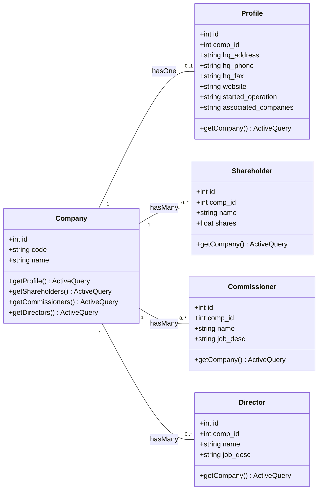

# Simple Profile - Implementasi & Modernisasi Yii 2

Aplikasi **Simple Profile** merupakan sistem manajemen profil perusahaan dan emiten terdaftar di Bursa Efek Indonesia (IDX). Dokumen ini berfokus pada arsitektur, implementasi teknis, dan rencana pengembangan aplikasi berbasis **Yii 2** (`yii2app/`), yang dikembangkan sebagai modernisasi dari versi Proof-of-Concept (PoC) berbasis Yii 1.

> [!NOTE]
> Untuk dokumentasi lengkap mengenai arsitektur, model, controller, dan alur kerja aplikasi versi PoC sebelumnya, silakan merujuk ke **[README-Yii1.md](README-Yii1.md)**.

---

## Daftar Isi
1. [Latar Belakang & Rujukan dari Yii 1](#1-latar-belakang--rujukan-dari-yii-1)
2. [Perbandingan Arsitektur: Yii 1 vs Yii 2](#2-perbandingan-arsitektur-yii-1-vs-yii-2)
3. [Struktur Direktori Aplikasi Yii 2 (`yii2app/`)](#3-struktur-direktori-aplikasi-yii-2-yii2app)
4. [Konfigurasi & Dependensi Modern](#4-konfigurasi--dependensi-modern)
5. [Desain Pemetaan & Porting Model (ActiveRecord)](#5-desain-pemetaan--porting-model-activerecord)
6. [Alur Master-Detail Emiten di Yii 2](#6-alur-master-detail-emiten-di-yii-2)
7. [Panduan Instalasi & Menjalankan Aplikasi](#7-panduan-instalasi--menjalankan-aplikasi)
8. [Pengujian Otomatis (Testing)](#8-pengujian-otomatis-testing)
9. [Roadmap Pengembangan](#9-roadmap-pengembangan)

---

## 1. Latar Belakang & Rujukan dari Yii 1

Pada versi awal (PoC), aplikasi dibangun menggunakan Yii 1.1.15 yang terletak di direktori `www/` dengan framework ter-bundle lokal di `framework/`. Meskipun telah berhasil mengimplementasikan alur master-detail profil emiten beserta data anak (pemegang saham, komisaris, direksi), versi tersebut memiliki batasan:
- Tidak memiliki manajemen dependensi otomatis (belum menggunakan Composer).
- Masih menggunakan UI Blueprint CSS klasik.
- Menggunakan query manual di view karena ketiadaan relasi deklaratif ActiveRecord.
- Skema tabel lama masih berbasis engine MyISAM.

Aplikasi versi **Yii 2** (`yii2app/`) dibangun untuk memodernisasi fondasi tersebut dengan mengadopsi standar PHP modern (PSR-4, namespaces, Composer), arsitektur modular, komponen keamanan bawaan, dan Bootstrap 4.

Rujukan komprehensif implementasi lama: **[README-Yii1.md](README-Yii1.md)**.

---

## 2. Perbandingan Arsitektur: Yii 1 vs Yii 2

| Aspek | Implementasi Yii 1 (`www/`) | Modernisasi Yii 2 (`yii2app/`) | Peningkatan & Alasan |
| :--- | :--- | :--- | :--- |
| **Framework Base** | Yii 1.1.15 (bundled di `framework/`) | Yii 2.0.48+ via Composer | Kemudahan update dependensi & patch keamanan. |
| **Dukungan PHP** | PHP 5.4 - 7.4 (tanpa namespace) | PHP 7.4 / 8.0+ (PSR-4 compliant) | Ekosistem modern dan performa tinggi. |
| **Manajemen Paket** | Manual copy file | Composer (`composer.json`, `composer.lock`) | Standar dependensi modern. |
| **ORM / Query** | `CActiveRecord` & `CDbCriteria` | `yii\db\ActiveRecord` & `yii\db\ActiveQuery` | Relasi deklaratif `hasOne`/`hasMany` & eager loading. |
| **UI & Layout** | Blueprint CSS framework (custom) | Bootstrap 4 (`yii2-bootstrap4`) | Desain responsif, mobile-friendly, dan bersih. |
| **Email Component** | SwiftMailer (deprecated) | Symfony Mailer (`yii2-symfonymailer`) | Kompatibilitas jangka panjang. |
| **Otentikasi** | In-memory array (`UserIdentity.php`) | `app\models\User` + interface `IdentityInterface` | Siap integrasi DB & RBAC. |
| **Keamanan** | MD5 / plaintext password | `Yii::$app->security` (bcrypt/Argon2) | Standar keamanan industri. |

---

## 3. Struktur Direktori Aplikasi Yii 2 (`yii2app/`)

Aplikasi Yii 2 menggunakan struktur **Yii 2 Basic Project Template**:

```text
yii2app/
├── assets/             # Definisi bundle aset (AppAsset.php, Bootstrap, jQuery)
├── commands/           # Console controller / CLI commands (e.g. migrasi, sinkronisasi data)
├── config/             # Konfigurasi aplikasi
│   ├── web.php         # Konfigurasi web application utama
│   ├── console.php     # Konfigurasi console application
│   ├── db.php          # Konfigurasi koneksi database MySQL
│   ├── params.php      # Parameter global aplikasi
│   └── test*.php       # Konfigurasi lingkungan testing
├── controllers/        # Web Controllers (SiteController, CompanyController, dll.)
├── mail/               # Layout & view template untuk pengiriman email
├── models/             # ActiveRecord models & form models
├── runtime/            # Log aplikasi, cache file, debug runtime
├── tests/              # Test suite Codeception (unit, functional, acceptance)
├── vagrant/            # Skrip provisioning Vagrant / VM
├── views/              # Template tampilan web (layouts, site, dll.)
├── web/                # Webroot publik (index.php, CSS, favicon, robots.txt)
├── widgets/            # Widget kustom antarmuka (Alert.php)
├── composer.json       # Definisi dependensi & skrip Composer
├── docker-compose.yml  # Definisi container Docker lokal
├── requirements.php    # Skrip pemeriksa kompatibilitas server PHP
└── yii                 # CLI executable Yii 2
```

---

## 4. Konfigurasi & Dependensi Modern

### A. Dependensi Utama (`yii2app/composer.json`)
- **PHP**: `^7.4 || ^8.0`
- **yiisoft/yii2**: `^2.0.48`
- **yiisoft/yii2-bootstrap4**: `^2.0`
- **yiisoft/yii2-symfonymailer**: `^2.0.3`
- **Testing & Dev**: `codeception/codeception: ^5.0`, `yiisoft/yii2-gii: ^2.2`, `yiisoft/yii2-debug: ^2.1`.

### B. Konfigurasi Database (`yii2app/config/db.php`)
Menghubungkan ke basis data `simple_profile`:
```php
return [
    'class' => 'yii\db\Connection',
    'dsn' => 'mysql:host=localhost;dbname=simple_profile',
    'username' => 'sp',
    'password' => 'sp',
    'charset' => 'utf8',
];
```

---

## 5. Desain Pemetaan & Porting Model (ActiveRecord)

Berdasarkan analisis implementasi Yii 1 pada [README-Yii1.md](README-Yii1.md), model-model di Yii 2 ditransformasikan dengan konvensi PSR-4 dan PascalCase singular:



### Implementasi Relasi Deklaratif di `app\models\Company`
Berbeda dengan Yii 1 yang method `relations()`-nya kosong, di Yii 2 setiap relasi didefinisikan secara ekspresif:

```php
namespace app\models;

use yii\db\ActiveRecord;

class Company extends ActiveRecord
{
    public static function tableName()
    {
        return 'companies';
    }

    public function rules()
    {
        return [
            [['code', 'name'], 'required'],
            ['code', 'string', 'max' => 5],
            ['name', 'string', 'max' => 100],
            ['code', 'unique'],
        ];
    }

    public function getProfile()
    {
        return $this->hasOne(Profile::class, ['comp_id' => 'id']);
    }

    public function getShareholders()
    {
        return $this->hasMany(Shareholder::class, ['comp_id' => 'id']);
    }

    public function getCommissioners()
    {
        return $this->hasMany(Commissioner::class, ['comp_id' => 'id']);
    }

    public function getDirectors()
    {
        return $this->hasMany(Director::class, ['comp_id' => 'id']);
    }
}
```

---

## 6. Alur Master-Detail Emiten di Yii 2

Pada implementasi Yii 2, alur master-detail ditingkatkan dengan pemanfaatan **Eager Loading** untuk menghindari masalah query $N+1$:

### Action di Controller (`CompanyController::actionView`)
```php
public function actionView($id)
{
    // Eager loading seluruh relasi terkait sekaligus dalam 1 batch query
    $model = Company::find()
        ->where(['id' => $id])
        ->with(['profile', 'shareholders', 'commissioners', 'directors'])
        ->one();

    if ($model === null) {
        throw new \yii\web\NotFoundHttpException('Perusahaan tidak ditemukan.');
    }

    return $this->render('view', [
        'model' => $model,
    ]);
}
```

### View (`views/company/view.php`)
Di Yii 2, tampilan menggunakan komponen bawaan yang lebih kaya:
- **`yii\widgets\DetailView`**: Untuk data perusahaan dan profil.
- **`yii\grid\GridView`**: Untuk data daftar pemegang saham, dewan komisaris, dan dewan direksi, menggunakan `ArrayDataProvider` atau `ActiveDataProvider`.
- **Bootstrap 4 Tabs / Cards**: Mengorganisir data anak menjadi tab terpisah ("Profil", "Pemegang Saham", "Dewan Komisaris", "Direksi") agar antarmuka lebih rapi dan informatif dibandingkan tampilan linear vertikal Yii 1.

---

## 7. Panduan Instalasi & Menjalankan Aplikasi

### A. Prasyarat Sistem
- PHP 7.4 atau PHP 8.0+
- Composer 2.x
- MySQL / MariaDB Server

### B. Langkah Instalasi Dependensi
Masuk ke direktori `yii2app/` dan jalankan composer:
```bash
cd yii2app
composer install
```

### C. Konfigurasi Basis Data
1. Pastikan database `simple_profile` sudah diinisialisasi (lihat skrip di `db/create-database.sql`).
2. Konversi tabel ke engine InnoDB jika belum dilakukan:
   ```sql
   ALTER TABLE companies ENGINE = InnoDB;
   ALTER TABLE profiles ENGINE = InnoDB;
   ALTER TABLE shareholders ENGINE = InnoDB;
   ALTER TABLE commisioners ENGINE = InnoDB;
   ALTER TABLE directors ENGINE = InnoDB;
   ```
3. Sesuaikan akun database di `yii2app/config/db.php`.

### D. Menjalankan Server Pengembangan

Tersedia beberapa cara untuk menjalankan aplikasi:

**1. Menggunakan CLI bawaan Yii:**
```bash
cd yii2app
./yii serve --port=8080
```

**2. Menggunakan Built-in PHP Server:**
```bash
php -S localhost:8080 -t yii2app/web
```

**3. Menggunakan Docker Compose:**
```bash
cd yii2app
docker-compose up -d
```

Akses aplikasi pada peramban melalui alamat: `http://localhost:8080`.

---

## 8. Pengujian Otomatis (Testing)

Aplikasi Yii 2 terintegrasi penuh dengan framework pengujian **Codeception**:

```bash
cd yii2app
# Menjalankan seluruh unit test dan functional test
vendor/bin/codecept run

# Menjalankan unit test saja
vendor/bin/codecept run unit

# Menjalankan functional test
vendor/bin/codecept run functional
```

---

## 9. Roadmap Pengembangan

- [x] Evaluasi dan dokumentasi perbandingan arsitektur Yii 1 ([README-Yii1.md](README-Yii1.md)).
- [x] Pembaruan dependensi modern Yii 2 (Yii 2.0.48, Symfony Mailer, Bootstrap 4).
- [ ] Porting lengkap model ActiveRecord Yii 2 (`Company`, `Profile`, `Shareholder`, `Commissioner`, `Director`).
- [ ] Implementasi UI Master-Detail interaktif berbasis Bootstrap 4 Tabs.
- [ ] Integrasi otentikasi pengguna berbasis basis data dengan hashing password.
- [ ] Pengumpulan & penyajian data indeks emiten Bursa Efek Indonesia:
  - Data emiten konstituen **IDX30**.
  - Data emiten konstituen **IDX45**.
  - Data emiten konstituen **IDX80**.
- [ ] Penyediaan RESTful API endpoint (`/api/v1/companies`) untuk konsumsi data pihak ketiga.
